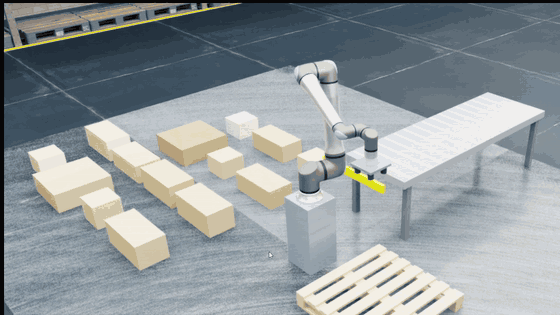

# Warehouse palletizing in Isaac Sim 6.0 and Isaac Lab: weight-adaptive grip, optimized pallets

<p align="center">
  <a href="pallet_builder_preview.gif">
    
  </a>
  <br>
  <em>The UR20 building an optimized mixed-case pallet in the warehouse (<code>pallet_builder.py</code>).
  
</p>

Robot cells that weigh each box, set their grip force from that weight, and stack boxes precisely:

| | **Heavy mixed-case pallet** | **Small-box sorter** |
|---|---|---|
| Scripts | `pallet_builder.py` (Isaac Sim, one cell) and `isaaclab_pallet_cells.py` (Isaac Lab, several cells in the warehouse) | `warehouse_box_sorter.py` (Isaac Sim) |
| Robot | Universal Robots **UR20**: **20 kg rated payload**, 1.75 m reach, on a 0.7 m pedestal | Franka Panda (3 kg payload) |
| Gripper | 4-cup vacuum gripper (4 kg), vacuum set from each box's weight | 1 vacuum cup (default) or the two-finger hand, both weight-adaptive |
| Boxes | 1.5–**16 kg** (16 kg box + 4 kg gripper = the full 20 kg payload). Three footprints (30×30, 60×30, 60×60 cm), three heights, stacking-strength labels (some fragile) | 81 identical 5.5 cm cubes, 0.1–2 kg |
| Pallet | 1.0 × 1.0 m wooden pallet, built as a 3×3×3 cube; the planner optimizes the layout | Three 3×3×3 cubes sorted by weight class |

### Filess

| File | What it is |
|---|---|
| `pallet_planner.py` | The pallet optimizer. Pure Python, runs on its own |
| `palletizer_core.py` | The UR20 palletizing controller: IK, vacuum gripper, wrist weighing, learning. Shared by both pallet scripts |
| `pallet_builder.py` | One heavy pallet cell in Isaac Sim (standalone) |
| `isaaclab_pallet_cells.py` | Several heavy pallet cells in the NVIDIA warehouse, in Isaac Lab |
| `warehouse_box_sorter.py` | The Franka small-box sorter in Isaac Sim |
| `docs/architecture.md` | How the code is organized and how the simulation models suction, weighing and payload |
| `docs/isaac_lab_setup.md` | Installing Isaac Lab for Isaac Sim 6.0 on Windows, including two fixes this install needed |
| `setup_isaaclab.ps1` | One-step Isaac Lab setup for this project: clones the right release, links Isaac Sim, applies the fixes, installs and verifies |
| `media/` | Demo video of the pallet builder (720p MP4) and the animated preview shown above |
| `report_figures/` | Case-competition report figures for Section 4 (architecture, control flowchart, cycle swimlane, vacuum circuit, weight data flow, cell layout) as PNG and SVG, with captions (`captions.md`) and the script that draws them (`make_figures.py`, needs matplotlib) |

## Run it

**Isaac Sim (standalone)**, from PowerShell:

```bash
cd C:\Users\APMayhaps\Downloads\isaac-sim-standalone-6.0.0-windows-x86_64
```

One heavy pallet cell (about 5 minutes per pallet; `--speed 4` to fast-forward):

```bash
.\python.bat C:\Users\APMayhaps\Downloads\IsaacSimProject\pallet_builder.py
```

Small-box sorter (about 13 seconds per box; `--num-boxes 27` for a quick look):

```bash
.\python.bat C:\Users\APMayhaps\Downloads\IsaacSimProject\warehouse_box_sorter.py
```

**Isaac Lab.** Install it once with the setup script, from PowerShell in this repo's folder (details in `docs/isaac_lab_setup.md`):

```bash
powershell -ExecutionPolicy Bypass -File .\setup_isaaclab.ps1
```

Then, from a Command Prompt:

```bash
cd /d C:\Users\APMayhaps\IsaacLab
```

Four pallet cells in the warehouse, with the viewer:

```bash
isaaclab.bat -p C:\Users\APMayhaps\Downloads\IsaacSimProject\isaaclab_pallet_cells.py --viz kit
```

**Just the pallet plan**, no simulation (under a second):

```bash
C:\Users\APMayhaps\Downloads\isaac-sim-standalone-6.0.0-windows-x86_64\kit\python\python.exe C:\Users\APMayhaps\Downloads\IsaacSimProject\pallet_planner.py --seed 11
```

---

## Heavy mixed-case pallet

### The machine and its payload

The UR20 is Universal Robots' palletizing cobot, rated for **20 kg at the flange**. That rating has to cover the gripper too:

| | Mass |
|---|---|
| Vacuum gripper (4 cups, plate, stem) | 4 kg |
| Heaviest box allowed | 16 kg |
| **Total at the flange** | **20 kg = the UR20's rated payload** |

* **Enforced, not just stated.** The gripper's 4 kg is added to the robot's flange link, so the arm really carries it. After weighing a box, the arm sets it back down and rejects it if box plus gripper would exceed 20 kg (allowing 0.2 kg of weighing tolerance). `--max-box-mass` (or `--max_box_mass` in Isaac Lab) defaults to 16 kg; a higher value prints a warning.
* **Joint torque limits** are the UR20's stock values: 730 / 730 / 430 / 100 / 100 / 100 N·m (confirmed at startup in Isaac Lab). The asset's wrist servos are soft for this payload, so their stiffness is raised; their torque limits are unchanged.
* **At full payload in testing:** the 16 kg box was placed within 0.2 mm in all four Isaac Lab cells and in the standalone cell. It peaked at 70% of a joint's torque limit and 60% of the seal's capacity.
* **Gripper capacity:** four 50 mm cups, 78.5 cm² in total, hold 628 N at full vacuum (80 kPa). A 16 kg box needs about 43 kPa.

### Each box

1. **Plan the pallet first.** The infeed's dimensioner and checkweigher give every box's size and weight up front. The planner (below) works out the whole pallet before anything is picked, and the buffer sends boxes to the conveyor in planned order.
2. **Seal and weigh.** The gripper seals on the box's top face at full vacuum and lifts it 8 cm. The UR20's flange force/torque sensor weighs it. The arm compares that weight with the checkweigher and flags any mismatch over 5%.
3. **Check the payload.** Box plus 4 kg gripper must be within the 20 kg rating.
4. **Set the vacuum from the weight.**

   ```
   F_hold = margin · SF · m · (g + a_max / 0.5)      vacuum = F_hold / cup area   (8–80 kPa)
   ```

   * The `0.5` is because a suction cup holds only about half as much sideways as straight up.
   * `SF` is 2.0 by default.
   * `margin` is learned.

   Every physics step, the real load on the cups, `m · (a + g)`, is compared with what the current vacuum can hold. If it's exceeded, the seal fails and the box drops.
5. **Move.** The arm swings over the pallet in joint space and turns the box to its planned orientation (2×1 boxes may be rotated 90°). Move durations grow with distance and with weight, so the arm stays on its path and the load on the cups stays as planned.
6. **Place.** The arm lowers the box, measures where it really is and corrects twice, then releases it 2 mm above its resting place.
7. **Check.** It records the placement error. At the end, the finished pallet stands for 2 seconds to check that nothing shifts.

### The pallet optimizer (`pallet_planner.py`)

The pallet is a 3×3 grid of 32 cm cells, three layers high. Every layer must be completely filled with boxes of the same height, so the next layer sits on a flat, fully supported surface.

**What it decides:**

* which boxes go in which layer,
* the order of the layers,
* each layer's pattern,
* which box goes in which spot, and whether 2×1 boxes are turned,
* the placement order. The farthest spot from the robot goes first, so the arm never lowers a box past one it has already placed.

**What it optimizes** (weighted costs; the crush rule is effectively a hard constraint):

| Goal | How it's measured |
|---|---|
| Heavy boxes low | Mass-weighted height of the load |
| Balance | Distance of the load's center of mass from the pallet center, for the whole load and for every partial stack |
| No crushing | Each box carries no more than its stacking-strength label. Load flows down through the boxes underneath, in proportion to their overlap |
| Interlocking | Share of seams that line up with seams in the layer below. Brick-like bonding holds a load together; aligned seams make weak columns |
| Large boxes low | Footprint area times layer |

**How it searches.** It starts from a greedy plan and improves it with simulated annealing (12,000 steps, under 1 second). The moves are:

* swap two boxes of the same shape and height,
* re-pattern a layer,
* reorder layers,
* trade a 2×1 box for two 1×1 boxes between layers of the same height.

Example, box set `--seed 11` (14 boxes, three of them fragile, heaviest 16 kg):

| | Arrival order | Optimized |
|---|---|---|
| Worst crush | 178% of rating (fragile box overloaded) | 82% |
| Load center of mass | 40 mm off center | 1.7 mm |
| Worst partial stack | 74 mm off center | 29 mm |
| Seams aligned with the layer below | 100% (columns) | 33% |

### Measured results (headless)

Box set `--seed 7`: 14 boxes, 103.2 kg, heaviest 16 kg.

| Run | Placed | Placement error (mean / max) | Weighing error | Seal losses | Peak joint torque | Center of mass off |
|---|---|---|---|---|---|---|
| Isaac Lab, 4 cells in the warehouse (each cell) | 14/14 | 0.38–0.39 / 0.80–0.84 mm | ≤ 0.02% | 0 | 70% of limit | 0.6 mm (plan 0.8) |
| Isaac Sim standalone, plain floor | 14/14 | 0.38 / 0.83 mm | 0.01% | 0 | 72% of limit | 0.6 mm (plan 0.8) |

Earlier runs with a 15 kg maximum (before the payload was raised to the full 20 kg) placed 14/14 boxes on box sets 7 and 11 at 0.16–0.36 mm mean error. A second practice episode cut the mean error from 0.36 to 0.16 mm.

The finished pallets didn't shift while standing (under 0.1 mm). The mean vacuum was about 25% of full: real cells regulate vacuum like this to save compressed air.

### Options (`pallet_builder.py`)

| Flag | Default | What it does |
|---|---|---|
| `--seed` | `7` | Which box set: sizes, weights, strengths, arrival order |
| `--max-box-mass` | `16` | Heaviest box in kg (the box set always includes one this heavy). Box plus 4 kg gripper must stay within 20 kg |
| `--no-optimize` | off | Build in arrival order, for comparison |
| `--episodes` | `1` | Build the pallet N times (practice) |
| `--safety-factor` | `2.0` | Safety factor on the vacuum holding force |
| `--weight-source` | `wrist` | `manifest` sets the vacuum from the checkweigher instead of the wrist sensor |
| `--plan-iters` | `12000` | Optimizer iterations |
| `--no-learning` / `--reset-learning` | off | Ignore or forget `learned_pallet.json` |
| `--env`, `--env-offset` | `warehouse` | Environment, as in the other script |
| `--headless` / `--test` / `--verbose` | off | No GUI / quit when done / print every step |
| `--speed N` | `1` | Fast-forward: N physics and control steps per rendered frame. Same results, up to N× faster in the GUI |

Practice learns per-spot placement corrections and the lowest safe vacuum margin. They're saved to `learned_pallet.json`, and each run is logged to `training_log_pallet.csv`.

### The cell

* **Robot.** The UR20 on a blue pedestal at the origin.
* **Pallet.** A wooden 1.0 × 1.0 m pallet in front of the robot (x = 0.88 m): bottom boards, 9 blocks, stringers and 7 deck boards, 14.4 cm tall.
* **Conveyor.** The infeed conveyor runs along +y and ends at a yellow stop next to the robot.
* **Buffer.** Boxes wait on the floor behind the robot. Color means weight: light tan is light, dark brown is heavy, and pale boxes are fragile.

---

## Isaac Lab: several cells in the warehouse (`isaaclab_pallet_cells.py`)

The same cell, imported into Isaac Lab and cloned into a grid inside NVIDIA's Simple_Warehouse. Each Isaac Lab environment is one complete cell: a UR20 (20 kg payload) with its 4 kg gripper, pedestal, conveyor, pallet and box buffer. Every cell runs its own controller from `palletizer_core.py`, so the behavior and results match the standalone version.

* **Layout.** Four cells, 6.5 m apart, fit on the open floor between the warehouse's side racks. The warehouse is shifted 1.6 m (`--env_offset`) so the cells sit centered. More than four cells would reach the racks; use `--env grid` (plain floor) for larger grids.
* **Same box set in every cell.** Isaac Lab clones one cell, so every cell gets the same boxes and builds the same optimized pallet.
* **Physics on the CPU.** The vacuum seals are joints created while the simulation runs, so the script defaults to `--device cpu`.
* **Speed.** The four cells together run in about the same time as one standalone cell. `--speed 4` fast-forwards.
* **Stop.** Pause works. Stop closes the run (restart the script to run again).

### Options (`isaaclab_pallet_cells.py`)

| Flag | Default | What it does |
|---|---|---|
| `--viz kit` | headless | Open the Isaac Sim viewer |
| `--num_cells` | `4` | Number of cells (4 fit in the warehouse) |
| `--cell_spacing` | `6.5` | Distance between cells, in metres |
| `--env` | `warehouse` | `warehouse` or `grid` (plain floor) |
| `--env_offset X Y Z` | `-1.6 0 0` | Shift the warehouse relative to the cells |
| `--max_box_mass` | `16` | Heaviest box in kg (box + 4 kg gripper = 20 kg payload) |
| `--seed`, `--episodes`, `--safety_factor`, `--no_optimize`, `--plan_iters`, `--weight_source` | as above | Same meaning as in `pallet_builder.py` |
| `--no_learning` / `--reset_learning` | off | Ignore or forget `learned_pallet_isaaclab.json` (shared by all cells) |
| `--speed N` | `1` | Fast-forward |
| `--log_steps` | off | Print every step of every box (Isaac Lab's own `--verbose` is its logging flag) |
| `--test` | off | Exit when every cell has finished |

Each cell's results go to `training_log_isaaclab.csv` (one row per cell and episode).

---

## Small-box sorter (`warehouse_box_sorter.py`)

A Franka Panda arm sorts up to 81 boxes (0.1–2 kg) by measured weight into LIGHT, MEDIUM and HEAVY zones and stacks each zone as a 3×3×3 cube.

### Grippers (`--gripper`)

* **`suction`** (default). A 40 mm vacuum cup mounted between the open fingers.
  * It seals at full vacuum, the wrist sensor weighs the box, then the vacuum is set from the weight: `F_hold = margin · SF · m · (g + a_max/0.5)`. The 2 kg boxes need about 37 kPa; the lightest need the 8 kPa minimum.
  * It holds rigidly, so boxes pack 7 mm apart.
* **`fingers`.** The original two-finger hand with a weight-adaptive squeeze: `drive = 16 N + margin · SF · m · (g + a)/(0.245 · μ)`, capped at 50 N per finger.
  * Boxes swivel slightly in the fingers, so stacking is about 10 mm accurate.

### Measured results (headless, plain floor)

| Gripper | Run | Stacked | Placement error (mean / max) | Weighing error | Drops |
|---|---|---|---|---|---|
| suction | 81 boxes (3 full cubes) | 81/81 | 0.12 / 0.65 mm | 0.3% | 0 |
| fingers | 27 boxes, 2 episodes | 25/27, then 27/27 | 10.0 / 56 mm, then 10.8 / 58 mm | 2.5% | 2, then 0 |

An 81-box run takes about 32 minutes with suction.

### How each box is handled

1. **Weigh.** The wrist sensor is zeroed once per episode. The arm grips the box (full vacuum, or a probe squeeze) and lifts it 6 cm, and the mass comes from the change in force.
2. **Set the grip** from the weight (formulas above). Heavier boxes also move more slowly.
3. **Carry and place.** The arm travels between stations in joint space and waits until it has really arrived. It measures where the box is and corrects twice, then lowers and releases it.
4. **Reset.** Before each pick, the arm returns to a ready posture.

**How it practices.** After each placement the arm stores a per-slot correction: `correction ← correction − 0.6 × error`. The grip/vacuum margin goes up after a slip or lost seal and down after a clean episode. Progress is saved to `learned_corrections_suction.json` (or `learned_corrections.json` for fingers) and logged to `training_log_suction.csv` (or `training_log.csv`).

### Options

`--gripper`, `--num-boxes` (1–81), `--episodes`, `--speed N` (fast-forward, as above), `--seed`, `--safety-factor` (default 2.0 suction / 1.25 fingers), `--friction`, `--probe-force`, `--weight-source`, `--no-learning`, `--reset-learning`, `--verbose`, `--env`, `--env-offset`, `--headless`, `--test`.

---

## Requirements

* Windows 11, NVIDIA GPU (tested on an RTX 4070 Ti, driver 616.64), 32 GB RAM.
* Isaac Sim 6.0.0 standalone (Windows zip). Assets stream from NVIDIA's asset server, so the first launch needs internet.
* For `isaaclab_pallet_cells.py`: Isaac Lab release `v3.0.0-beta2.patch1` (the release for Isaac Sim 6.0). See `docs/isaac_lab_setup.md`.

See `docs/architecture.md` for simulator notes: how suction, weighing and the payload are modeled, and the Isaac Sim quirks the scripts work around.
